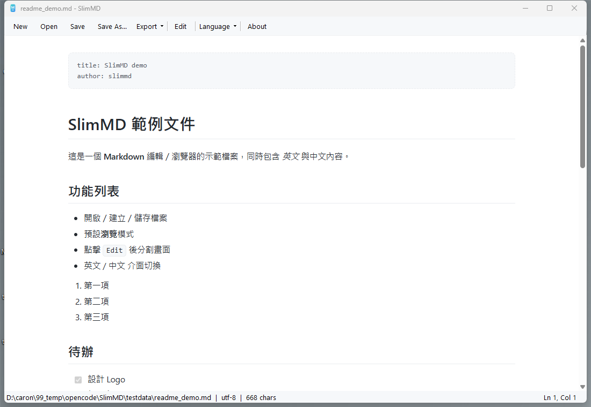
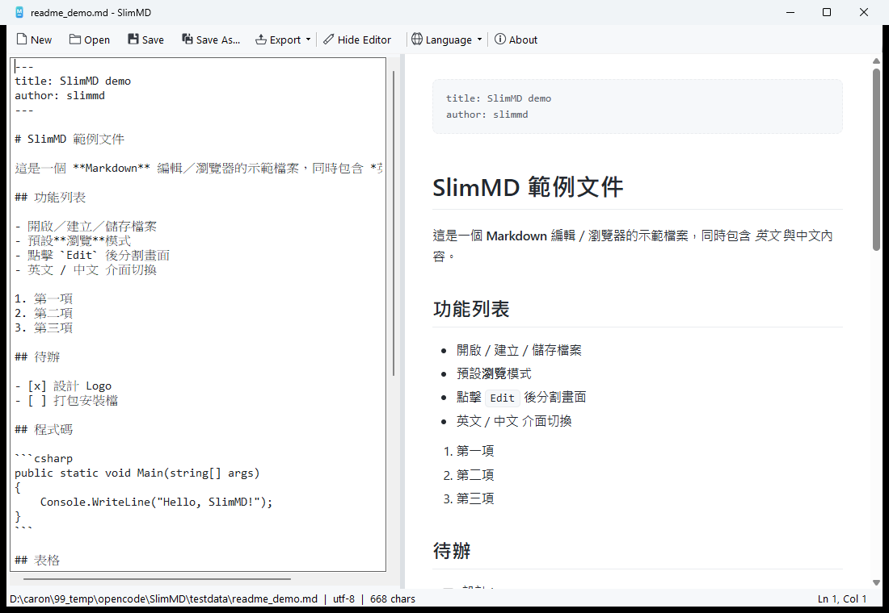
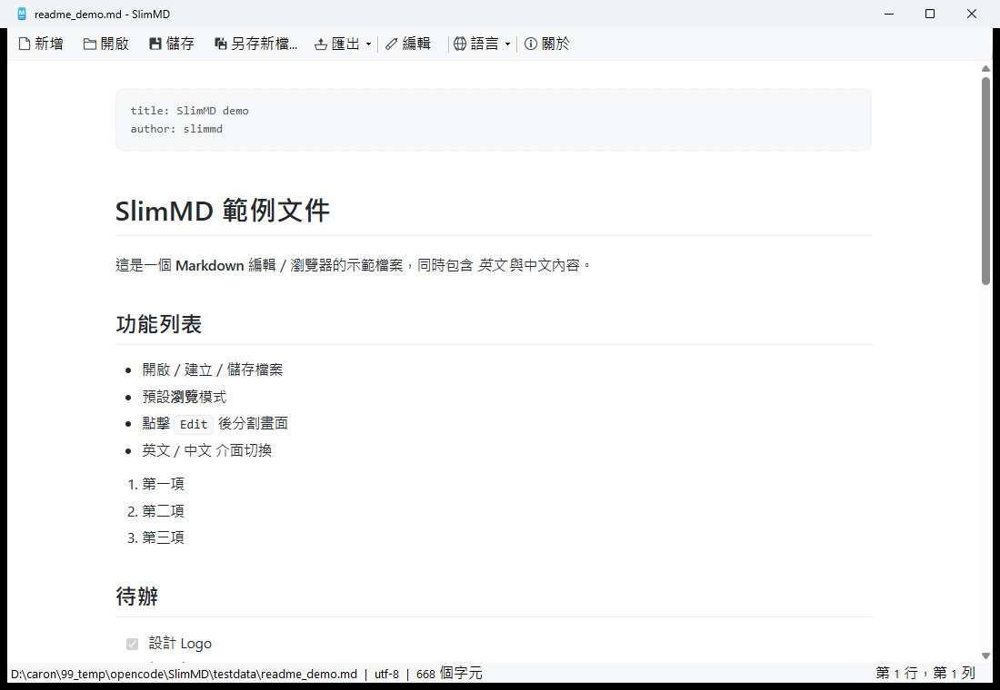
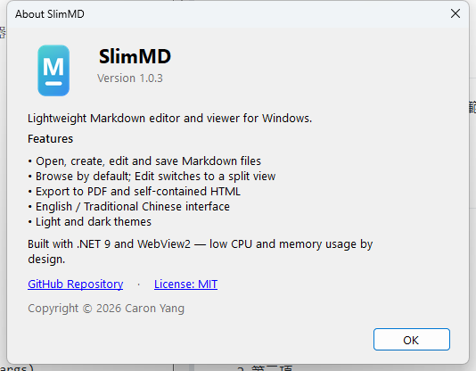

# SlimMD

[English](README.md) | [繁體中文](README.zh-Hant.md)

**SlimMD is a free, open-source Markdown editor and viewer for Windows** — a
lightweight alternative to Electron-based Markdown apps. Built with .NET 9
WinForms and WebView2, it stays fast and light on CPU and memory, starts
instantly, and handles `.md` files with proper encoding (UTF-8 / Big5 / GBK).



## Features

- **Browse view by default** — clean rendered preview, distraction free.
- **Edit** — click the toolbar button (or press `Ctrl+E` / `F9`) to switch to a
  split view with the raw Markdown source on the left and the live preview on
  the right. Click **Hide Editor** to go back.

  

- **Block-based scroll sync** — the editor and the preview stay aligned by
  *content block*, not by a proportional position: every rendered block knows
  the source line it came from, so scrolling either pane jumps the other to the
  matching section (editing at `## 4.` shows `4.` in the preview), even though
  the two panes never have the same amount of content per screen.

- **Open / New / Save / Save As** — `Ctrl+O`, `Ctrl+N`, `Ctrl+S`, `Ctrl+Shift+S`.
  All shortcuts work in both browse and edit view. Drag & drop `.md` files
  onto the window to open them. Files can also be passed on the command line:
  `SlimMD.exe notes.md todo.md`.
- **Multiple documents in tabs** — open as many Markdown files as you like;
  each one gets its own tab above the preview, with an **✕** close button on
  the tab header. Switching tabs switches the single editor pane to that
  document, and save/export always act on the active tab. Unsaved tabs are
  marked with `*`.
- **Unsaved-changes prompt** — closing a tab or the window while a document
  has unsaved edits asks you to save first (Yes / No / Cancel).
- **Encoding done right** — UTF-8 (with or without BOM) is detected
  automatically, with fallback to the system ANSI code page (Big5 / GBK /
  Windows-1252 …). The file's original line-ending style (CRLF / LF) and
  encoding are preserved on save.
- **English / 中文 interface** — switch any time from the **Language** toolbar
  menu; the choice is remembered.

  

- **Export** — the **Export** toolbar menu writes the document out as
  **PDF** (A4, print stylesheet, backgrounds kept, no header/footer) or as a
  self-contained **HTML** file (styles inlined, relative image/link paths
  rewritten so the page works from wherever you save it).
- **About dialog** — logo, version, feature list, repository and license links.

  

- **Light & dark themes** that follow the system setting.
- **Markdown support**: headings, paragraphs, emphasis, links, images, lists
  (ordered / task lists), blockquotes, fenced code blocks (with language
  label), tables, horizontal rules, inline code, strikethrough, HTML
  front-matter block, and raw HTML (sanitized whitelist).
- **Links open in your browser**, not inside the app.
- **Self-contained** — no .NET runtime installation needed.

## Requirements

- Windows 10 1809+ / Windows 11 (x64)
- Microsoft Edge WebView2 Runtime (preinstalled on Windows 11; the installer
  detects it and links to the download if missing)

## Install

Run `dist\SlimMD-1.0.0-Setup.exe` — a per-user install (no admin rights
required), to `%LOCALAPPDATA%\Programs\SlimMD`.

Optional tasks in the installer: desktop shortcut, `.md` file association.

To uninstall: *Settings → Apps → SlimMD*, or `unins000.exe` in the install
folder.

### Silent install

```
SlimMD-1.0.0-Setup.exe /VERYSILENT /SUPPRESSMSGBOXES /NORESTART
```

## Build from source

Prerequisites: .NET 9 SDK, Inno Setup 6, (optional) Node.js for renderer
tests, (optional) Python + Pillow to regenerate the logo.

```powershell
powershell -ExecutionPolicy Bypass -File build.ps1
```

This runs: icon generation → build → renderer tests → self-contained publish →
installer compile. Output lands in `dist\SlimMD-<version>-Setup.exe`.

Useful flags: `-SkipIcon`, `-SkipTests`, `-SkipInstaller`.

## Tests

| Command | What it covers |
|---|---|
| `node tests\render.test.js` | Markdown renderer — 58 unit tests |
| `powershell -File tools\e2e.ps1` | UI end-to-end — 34 checks (browse/split toggle, shortcuts from both views, selection, export menu, About dialog, EN/ZH switch, settings persistence) |
| `powershell -File tools\export-test.ps1` | Export flow (menu → Save dialog → PDF/HTML on disk) — 17 checks |
| `powershell -File tools\tabs-test.ps1` | Multi-tab documents + unsaved-close prompt + tab ✕ close button — 15 checks |
| `powershell -File tools\scroll-test.ps1` | Editor ↔ preview scroll synchronisation (both directions) — 4 checks |
| `powershell -File tools\blocksync-test.ps1` | Block-based scroll sync: editor top line ↔ preview top section stay aligned — 6 checks |
| `powershell -File tools\installer-test.ps1` | Shipped installer: silent install → run → Export menu → uninstall — 6 checks |

## Project layout

```
SlimMD.sln
src\SlimMD\            WinForms app
  MainForm.cs          toolbar, split view, file I/O, PDF/HTML export, settings
  AboutDialog.cs       About dialog
  AppInfo.cs           repository / license / copyright constants
  Strings.cs           EN/ZH UI strings
  MsgDialog.cs         localized dialogs
  AppSettings.cs       persisted settings (%LOCALAPPDATA%\SlimMD\settings.json)
  assets\              preview.html / preview.css / preview.js (renderer)
  SlimMD.ico           program logo
tests\render.test.js   renderer unit tests
tools\                 logo generator, E2E/export/installer test scripts, helpers
installer\SlimMD.iss    Inno Setup script
build.ps1              full build pipeline
```

## Debugging

Set `SLIMMD_DEBUG=1` in the environment before launching to append logs to
`%LOCALAPPDATA%\SlimMD\debug.log`.

## License

[MIT](LICENSE) © 2026 Caron Yang.
