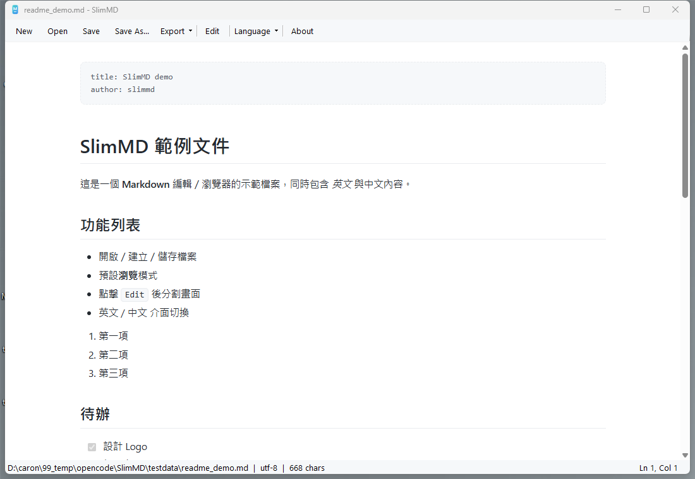
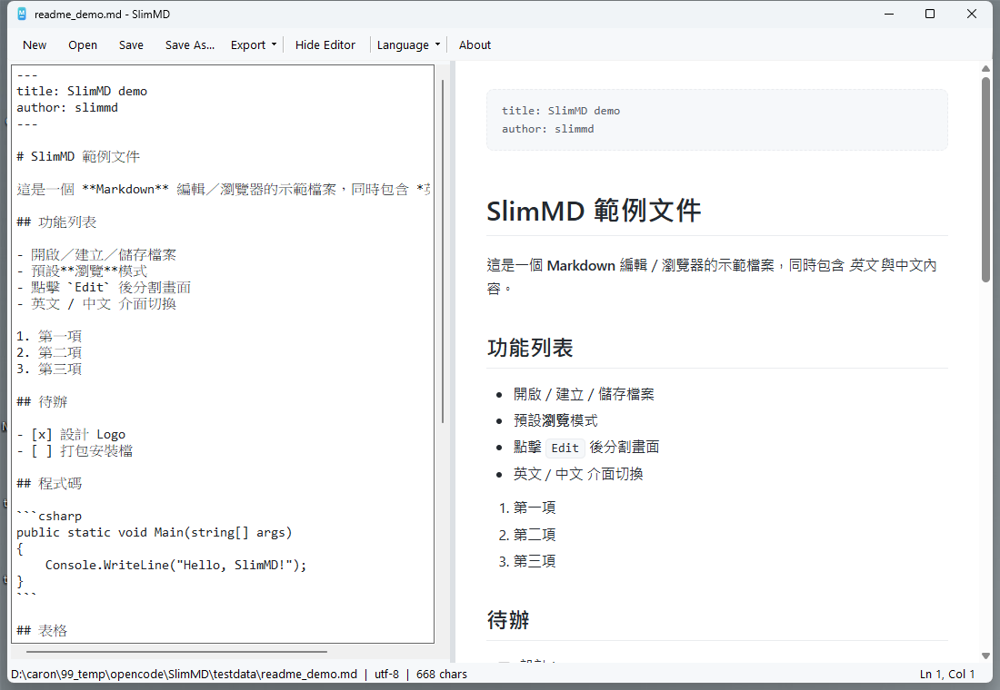
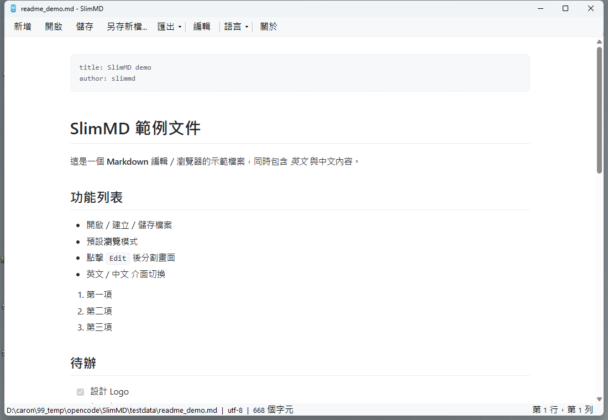
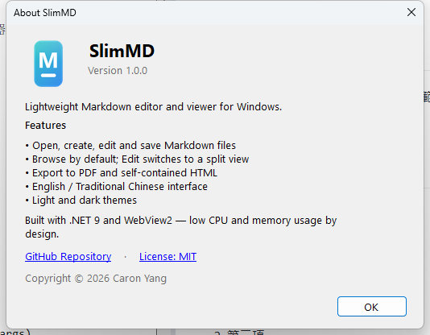

# SlimMD

[English](README.md) | [繁體中文](README.zh-Hant.md)

適用於 Windows 的輕量級 Markdown 編輯器與檢視器 — 使用 .NET 9 WinForms 與
WebView2 打造，CPU 與記憶體佔用低、啟動快速（非 Electron）。



## 功能

- **預設瀏覽模式** — 乾淨的渲染預覽，專心閱讀不分心。
- **編輯** — 點選工具列按鈕（或按 `Ctrl+E` / `F9`）切換為分割檢視：左側是
  Markdown 原始碼，右側是即時預覽。點選**隱藏編輯區**即可切回。

  

- **開啟 / 新建 / 儲存 / 另存新檔** — `Ctrl+O`、`Ctrl+N`、`Ctrl+S`、
  `Ctrl+Shift+S`，瀏覽與編輯模式皆可使用。也可將 `.md` 檔拖放至視窗開啟，
  或在命令列傳入檔案：`SlimMD.exe notes.md`。
- **編碼正確處理** — 自動偵測 UTF-8（含/不含 BOM），並回退至系統 ANSI
  碼頁（Big5 / GBK / Windows-1252 …）。儲存時保留檔案原有的行尾格式
  （CRLF / LF）與編碼。
- **英文 / 中文介面** — 隨時從工具列的**語言**選單切換，設定會被記住。

  

- **匯出** — 工具列的**匯出**選單可將文件輸出為 **PDF**（A4、列印樣式、
  保留背景、無頁首頁尾）或自帶樣式的 **HTML** 檔（樣式內嵌、相對路徑的
  圖片／連結已改寫，檔案搬到哪裡都能正常顯示）。
- **關於對話框** — 標誌、版本、功能列表、儲存庫與授權連結。

  

- **亮色 / 暗色主題**，跟隨系統設定。
- **Markdown 支援**：標題、段落、強調、連結、圖片、清單（有序／任務清單）、
  引用、圍欄程式碼區塊（含語言標籤）、表格、水平線、行內程式碼、刪除線、
  HTML front-matter 區塊，以及原始 HTML（白名單過濾）。
- **連結以系統瀏覽器開啟**，不會在程式內瀏覽。
- **免安裝執行環境** — 不需另外安裝 .NET 執行環境。

## 系統需求

- Windows 10 1809+ / Windows 11（x64）
- Microsoft Edge WebView2 Runtime（Windows 11 已內建；安裝程式會自動偵測，
  缺少時提供下載連結）

## 安裝

執行 `dist\SlimMD-1.0.0-Setup.exe` — 僅安裝給目前使用者（不需要系統管理員
權限），預設安裝至 `%LOCALAPPDATA%\Programs\SlimMD`。

安裝程式提供選用項目：桌面捷徑、`.md` 檔關聯。

解除安裝：*設定 → 應用程式 → SlimMD*，或執行安裝資料夾中的 `unins000.exe`。

### 靜默安裝

```
SlimMD-1.0.0-Setup.exe /VERYSILENT /SUPPRESSMSGBOXES /NORESTART
```

## 從原始碼建置

前置需求：.NET 9 SDK、Inno Setup 6、（選用）Node.js 執行渲染器測試、
（選用）Python + Pillow 重新產生圖示。

```powershell
powershell -ExecutionPolicy Bypass -File build.ps1
```

執行內容：圖示產生 → 建置 → 渲染器測試 → 自足式發佈 → 安裝檔編譯。
產物位於 `dist\SlimMD-<version>-Setup.exe`。

常用旗標：`-SkipIcon`、`-SkipTests`、`-SkipInstaller`。

## 測試

| 指令 | 涵蓋範圍 |
|---|---|
| `node tests\render.test.js` | Markdown 渲染器 — 58 個單元測試 |
| `powershell -File tools\e2e.ps1` | UI 端對端 — 34 項檢查（瀏覽/分割切換、兩種模式的快捷鍵、文字選取、匯出選單、關於對話框、中英切換、設定持久化） |
| `powershell -File tools\export-test.ps1` | 匯出流程（選單 → 儲存對話框 → PDF/HTML 落盤）— 17 項檢查 |
| `powershell -File tools\installer-test.ps1` | 正式安裝檔：靜默安裝 → 執行 → 匯出選單 → 解除安裝 — 6 項檢查 |

## 專案結構

```
SlimMD.sln
src\SlimMD\            WinForms 應用程式
  MainForm.cs          工具列、分割檢視、檔案 I/O、PDF/HTML 匯出、設定
  AboutDialog.cs       關於對話框
  AppInfo.cs           儲存庫 / 授權 / 版權常數
  Strings.cs           中英文 UI 字串
  MsgDialog.cs         在地化對話框
  AppSettings.cs       持久化設定（%LOCALAPPDATA%\SlimMD\settings.json）
  assets\              preview.html / preview.css / preview.js（渲染器）
  SlimMD.ico           程式圖示
tests\render.test.js   渲染器單元測試
tools\                 圖示產生器、E2E/匯出/安裝檔測試腳本與輔助工具
installer\SlimMD.iss    Inno Setup 腳本
build.ps1              完整建置管線
```

## 偵錯

啟動前於環境變數設定 `SLIMMD_DEBUG=1`，日誌會追加寫入
`%LOCALAPPDATA%\SlimMD\debug.log`。

## 授權

[MIT](LICENSE) © 2026 Caron Yang。
